<div align="center">
  <picture>
    <source media="(prefers-color-scheme: dark)" srcset="docs/banner-dark.svg" />
    <source media="(prefers-color-scheme: light)" srcset="docs/banner-light.svg" />
    
  </picture>
</div>

<br>

<div align="center">

[![Tests][tests-badge]][tests-url]
[![Live site][site-badge]][site-url]
[![GitHub Marketplace][market-badge]][market-url]
[![Action release][release-badge]][release-url]
[![Python][python-badge]][python-url]
[![MIT license][license-badge]][license-url]

</div>

  [tests-badge]: https://github.com/PasinduSuraweera/timeline/actions/workflows/test.yml/badge.svg
  [tests-url]: https://github.com/PasinduSuraweera/timeline/actions/workflows/test.yml
  [site-badge]: https://badgen.net/badge/site/timeline-readme.vercel.app/ff6a3d?labelColor=374151
  [site-url]: https://timeline-readme.vercel.app/
  [market-badge]: https://badgen.net/badge/marketplace/Timeline/ff6a3d?icon=github&labelColor=374151
  [market-url]: https://github.com/marketplace/actions/timeline
  [release-badge]: https://badgen.net/github/release/PasinduSuraweera/timeline-action?label=action&labelColor=374151&color=ff6a3d
  [release-url]: https://github.com/PasinduSuraweera/timeline-action/releases
  [python-badge]: https://badgen.net/badge/python/3.10%2B%20stdlib/ff6a3d?labelColor=374151
  [python-url]: https://github.com/PasinduSuraweera/timeline/tree/main/timeline
  [license-badge]: https://badgen.net/github/license/PasinduSuraweera/timeline?labelColor=374151&color=ff6a3d
  [license-url]: LICENSE

# Timeline

Your GitHub contribution year, rendered as a wave with something riding it.

Each week of your calendar becomes one swell. The band scrolls forever, a sparkle runs along the crest, and a small pixel figure steps up and down as the water passes under it. It is one animated SVG, generated per request, so it follows your calendar without you touching it again.

This started as the header on [my profile](https://github.com/PasinduSuraweera) and was pulled out so anyone can point it at their own username.

## Use it

Pick your settings at [timeline-readme.vercel.app](https://timeline-readme.vercel.app/), or write the URL by hand:

```
[](https://github.com/YOUR_USERNAME)
```

There is a shorter form for the plain case:

```

```

To commit the SVG to your own repo on a schedule instead, use the [Timeline Action](https://github.com/marketplace/actions/timeline).

## Themes

Add `&theme=` to the URL.

| | | |
| :---: | :---: | :---: |
| <br>`ember` | <br>`ice` | <br>`matrix` |
| <br>`grape` | <br>`rose` | <br>`gold` |
| <br>`mono` | <br>`daylight` | <br>`paper` |

## Riders

Add `&rider=` to the URL.

| | | | | |
| :---: | :---: | :---: | :---: | :---: |
| <br>`surfer` | <br>`sail` | <br>`buoy` | <br>`flag` | <br>`none` |

---

Built by [PasinduSuraweera](https://github.com/PasinduSuraweera).
